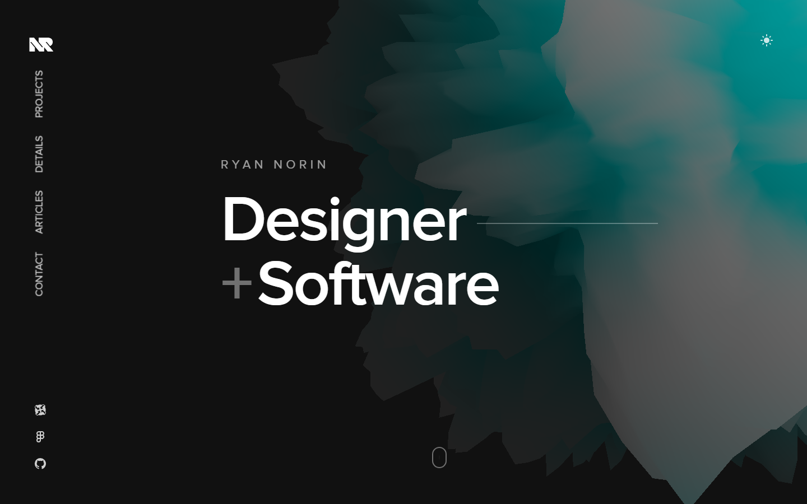

<p align="center">
  
</p>
<h1 align="center">Ryan Norin — Portfolio</h1>

[](https://e-portfolio.nironr6.workers.dev)

A personal site where I showcase my professional and personal work as a software engineer. Built with [Remix](https://remix.run/), [Three.js](https://threejs.org/) and [Framer Motion](https://www.framer.com/motion/), and hosted on [Cloudflare Workers](https://workers.cloudflare.com/). View the [live site](https://e-portfolio.nironr6.workers.dev).

## Install & run

You'll need Node.js `20` or higher. Clone the repo and install dependencies:

```bash
git clone https://github.com/NironR/e-portfolio.git
cd e-portfolio
npm install
```

Start the local dev server at [localhost:5173](http://localhost:5173):

```bash
npm run dev
```

To browse the components in Storybook at [localhost:6006](http://localhost:6006):

```bash
npm run storybook
```

## Scripts

| Command | What it does |
| --- | --- |
| `npm run dev` | Start the Remix dev server |
| `npm run build` | Production build into `build/` |
| `npm run preview` | Build, then serve it locally with the Cloudflare Workers runtime (`wrangler dev`) — the closest thing to production |
| `npm run typecheck` | Type-check with TypeScript |
| `npm run lint` | Lint with ESLint |
| `npm run check` | Type-check, build and do a deploy dry run in one go |
| `npm run storybook` | Start Storybook |
| `npm run build-storybook` | Build a static Storybook into `storybook-static/` |
| `npx playwright test` | Run the end-to-end tests in `tests/` (starts the dev server for you) |
| `npm run deploy` | Deploy to Cloudflare Workers manually |

## Deployment

The site is deployed with [Cloudflare Workers Builds](https://developers.cloudflare.com/workers/ci-cd/builds/):

- **Every pull request** gets its own preview deploy. The Cloudflare bot comments on the PR with a preview URL.
- **Merging into `main`** deploys to production.

To deploy manually instead (requires being logged in with `npx wrangler login`):

```bash
npm run deploy
```

> Some bugs only show up in production builds (for example, CSS imported purely for side effects). Run `npm run preview` or `npm run check` before merging anything that touches styles or build config.

## Project structure

```
app/
├── routes/                 # Pages: home, project pages (e.g. projects.f1-race-predictor)
│   └── home/               # Intro, project summaries, profile, displacement sphere
├── components/             # Reusable UI (button, heading, image, model, text, …) + their stories
│   └── theme-provider/     # Design tokens (theme.ts) and the light/dark theme context
├── layout/                 # Navbar (incl. mobile menu and theme toggle), project page layout
├── hooks/                  # useWindowSize, useScrollToHash, useInViewport, …
├── assets/                 # Images, fonts, 3D models, favicon
├── global.css              # Global styles + @custom-media breakpoint definitions
└── root.tsx                # App shell: theme cookie, navbar, global styles
public/draco/               # Draco decoder used to load compressed 3D models
.storybook/                 # Storybook config (applies the app theme to stories)
tests/                      # Playwright end-to-end tests
```

## Credits & permissions

This site is built on [HamishMW/portfolio](https://github.com/HamishMW/portfolio) by Hamish Williams, used under the [MIT License](LICENSE). I've adapted the design, theme and components to make it my own.

You're welcome to read the code and borrow parts of it for your own site. If you reuse the overall design largely unmodified, please credit [Hamish Williams](https://hamishw.com) as its original designer.

Please don't present any of my projects as your own — this is my real portfolio, and the projects on it are work I've done.

## FAQs

<details>
  <summary>How do I change the colours or the light/dark palette?</summary>

  All design tokens live in `app/components/theme-provider/theme.ts`. The `dark` and `light` objects set the background, text, primary and accent colours for each theme; shared tokens (spacing, durations, font weights) are in `baseTokens`. The visitor's theme choice is saved in a `theme` cookie so the server renders it without a flash.
</details>

<details>
  <summary>How do I change the colour of the <code>DisplacementSphere</code> (the rotating blob behind the intro)?</summary>

  Edit the fragment shader in `app/routes/home/displacement-sphere-fragment.glsl`. Lighting strength per theme is set in `app/routes/home/displacement-sphere.tsx`.
</details>

<details>
  <summary>Where are the responsive breakpoints?</summary>

  CSS breakpoints are defined once as `@custom-media` rules at the top of `app/global.css` (e.g. `--mediaMobile` is `max-width: 696px`) and used as `@media (--mediaMobile)` in any CSS file. `postcss.config.js` injects those definitions into every file at build time. The same pixel values are mirrored in JavaScript in `app/utils/styles.ts` (`media`) — keep the two in sync if you change one.
</details>

<details>
  <summary>How do I add a new project?</summary>

  1. Add a `ProjectSummary` to `app/routes/home/home.tsx` with the next `id` (e.g. `project-2`), a title, description, button link and device model textures from `app/assets/`.
  2. Create the project's page as a new route, following `app/routes/projects.f1-race-predictor/route.tsx`.
  3. The laptop and phone models are Draco-compressed; their decoder is already served from `public/draco/`, so no extra setup is needed.
</details>
